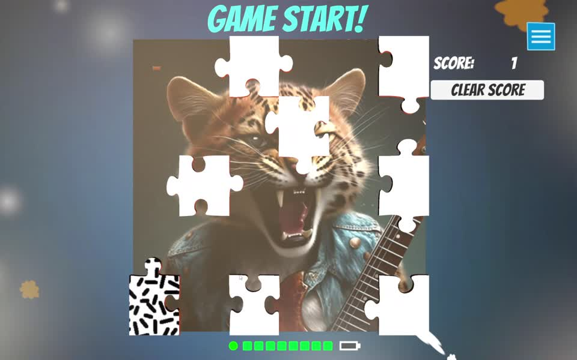
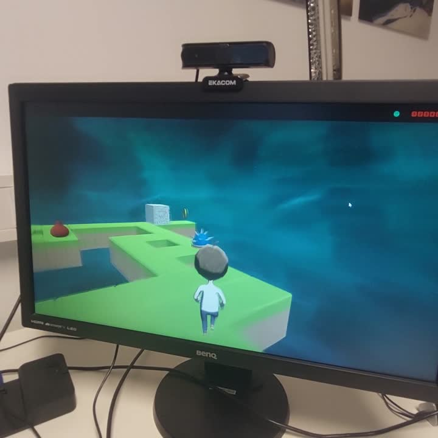

# 30 brain commands after 30 seconds of calibration (c-VEP for Unity and Meta Quest)

**In short:** g.tec's code-modulated visual evoked potential (c-VEP) add-on turns the Unicorn into a **hands-free input device for Unity, VR and XR apps**. After about 30 seconds of calibration on one flickering target, the user selects any of **30 targets** just by looking at them, about **2 seconds per command**. It runs with the Unicorn BCI Core-4 Headband (€390) and the Unicorn BCI Core-8, on PC and on Meta Quest, and comes **free** with the Unicorn Unity interface.

## Demo 1: 30 targets
Video: [cvep-30-targets-demo.mp4](cvep-30-targets-demo.mp4) (3:20, 8-channel Unicorn cap, PC screen).

1. **Signal check:** the app asks the user to check EEG quality.
2. **Calibration:** "Please focus!" One target flickers with a pseudo-random code while the user looks at it. In the video this takes about 34 seconds, then "Training completed".
3. **Selection:** a 5 × 6 grid of 30 targets, each flickering with its own shifted code. The decoder recognizes which target the user looks at and moves from one block to the next. In this demo every selection was correct (g.tec).

## Demo 2: Unicorn BCI Puzzle Game
Video: [unicorn-bci-puzzle-game.mp4](unicorn-bci-puzzle-game.mp4) (5:00, screen recording). A short training on one flickering puzzle piece, then the player completes picture puzzles by looking at the piece to flip. Score and levels unlock as in any casual game.

## Demo 3: Unicorn Platformer Game
Video: [unicorn-bci-platformer-game.mp4](unicorn-bci-platformer-game.mp4) (2:57, 8-channel Unicorn cap, PC screen). A 3D platformer in which the player crushes obstacles with brain signals to clear the path, built in Unity.

## Why c-VEP
Every target flickers with a shifted copy of the same code, so one short calibration on one target is enough to recognize all of them. That keeps setup short and allows many commands: menus, keyboards, games and object selection in VR, without controllers or hand tracking.

## Status of the numbers
Calibration time, the 30-target grid and the selections are shown in g.tec's demo videos (one user each). The Puzzle and Platformer games are part of the [Unicorn Suite](https://www.gtec.at/product/unicorn-suite/). The 2 seconds per command and the 100% correct selections are g.tec's figures from these demos, not a published study.

## Try it
- [Unicorn Labyrinth Game](https://github.com/unicorn-bi/Unicorn-BCI-Core-Labyrinth-Game): free brain-controlled game for the Core-4 and Core-8, on [Meta Quest](https://www.meta.com/en-gb/experiences/unicorn-labyrinth-game/27322060354048623/), [Google Play](https://play.google.com/store/apps/details?id=com.gtec.labyrinth) and GitHub.
- [Unity Bandpower Interface](https://github.com/unicorn-bi/Unicorn-BCI-Core-Unity-Bandpower-Interface) for relaxation, attention and neurofeedback input.

Related: [VR/XR for €390](../vr-xr-for-390-euro/README.md), [visual evoked potential from dry electrodes](../visual-evoked-potential/README.md).
