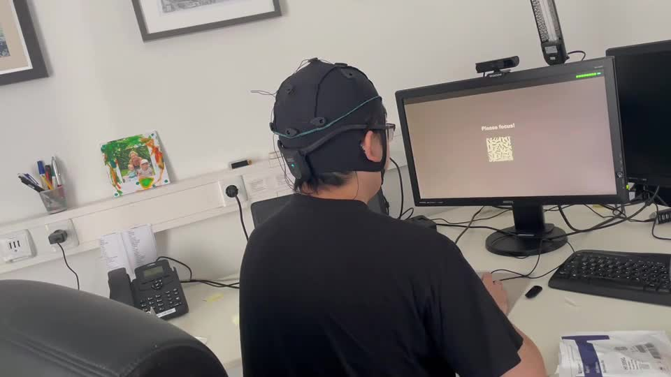
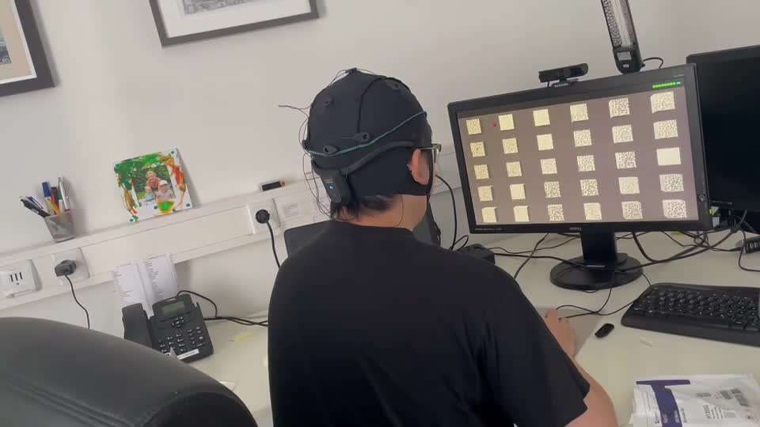

# 30 brain commands after 30 seconds of calibration (c-VEP)

**In short:** with a code-modulated visual evoked potential (c-VEP) BCI from g.tec, a user calibrates by looking at one flickering target for about 30 seconds, then selects any of **30 targets** with their gaze-driven brain response, about **2 seconds per command**. It runs with the Unicorn BCI Core-4 Headband and the Unicorn BCI Core-8, on a PC and on Meta Quest, as a software add-on to the Unicorn Unity interface.

## What the demo shows
1. **Signal check:** the app first asks the user to check EEG quality.
2. **Calibration:** "Please focus!" One target flickers with a pseudo-random code while the user looks at it. In the demo video this takes about 34 seconds, then "Training completed".
3. **Selection:** a 5 × 6 grid of 30 targets, each flickering with its own shifted code. The decoder recognizes which target the user looks at and moves from one block to the next.

## Why c-VEP
Every target flickers with a shifted copy of the same code, so one short calibration on one target is enough to recognize all of them. That keeps setup short and allows many commands, which is why c-VEP suits games, menus and spellers in VR.

## Status of the numbers
The calibration time and the 30-target grid are visible in g.tec's demo video (recorded with an 8-channel Unicorn cap on a PC screen). The 2 seconds per command is g.tec's figure. Accuracy figures and a validation reference will be added here.

Related: [VR/XR for €390](../vr-xr-for-390-euro/README.md), [visual evoked potential from dry electrodes](../visual-evoked-potential/README.md).
