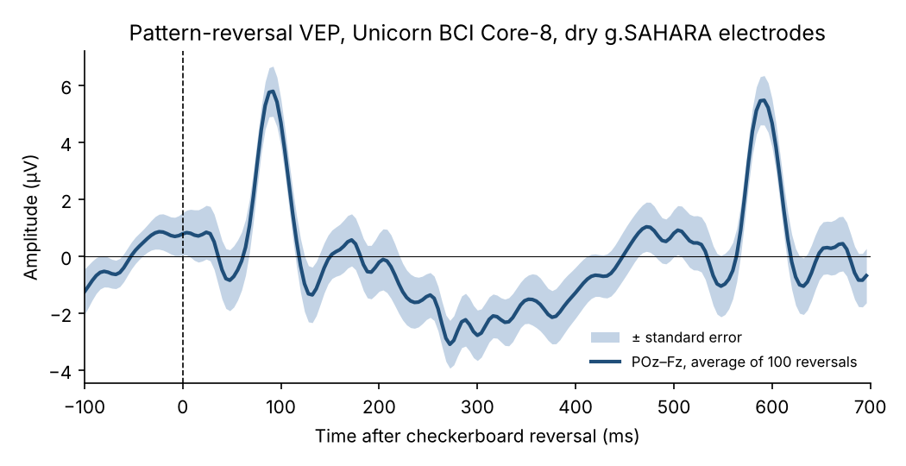

# A textbook visual evoked potential from dry electrodes

**In short:** with the Unicorn BCI Core-8 and dry g.SAHARA electrodes, a 1 Hz checkerboard pattern reversal gives a clean P100 of **5.8 µV at 92 ms** (POz–Fz, average of 100 reversals). That is the amplitude and latency a pattern-reversal VEP should have. Anyone can reproduce it from the open data with the script in this folder.

## What you see
- **N75 – P100 – N135:** the classic pattern-reversal complex. P100 peaks at 92 ms with 5.8 µV; N75 to P100 is 6.5 µV peak to peak.
- **The second peak at about 590 ms** is the P100 of the next reversal, 500 ms later, not a separate component.
- **Noise:** the baseline of the average stays within about ±1 µV; its RMS at POz is 0.34 µV.

## Data and method
- **Device:** Unicorn BCI Core-8, 8 channels (Fz, C3, Cz, C4, Pz, PO7, POz, PO8), 250 Hz, g.SAHARA hybrid electrodes **without gel**, right-mastoid reference, recorded in an office.
- **Data:** the raw CSV from the open [Unicorn BCI Core-8 EEG datasets](https://github.com/unicorn-bi/Unicorn-BCI-Core-8-EEG-Datasets/tree/main/Datasets/VEPReversal) (one participant, 100 reversals).
- **Processing** ([vep.py](vep.py)): 0.5–40 Hz band-pass and 50/100 Hz notch filters (zero-phase), epochs from −100 to 700 ms around each reversal, baseline correction on −100 to 0 ms, average of all 100 epochs, POz minus Fz. No trials rejected, no artifact correction.

To run it: `pip install numpy scipy matplotlib`, download the raw CSV, then `python vep.py UnicornRawDataRecorder_15_07_2026_16_32_310.csv vep.png`.

## Why it matters
An evoked potential is a good check of an EEG system: its amplitude is a few microvolts, so amplifier noise, electrode contact, timing jitter or a wrong scaling show up at once. Ask any vendor for the raw file behind their evoked-potential plot and run the same script.
