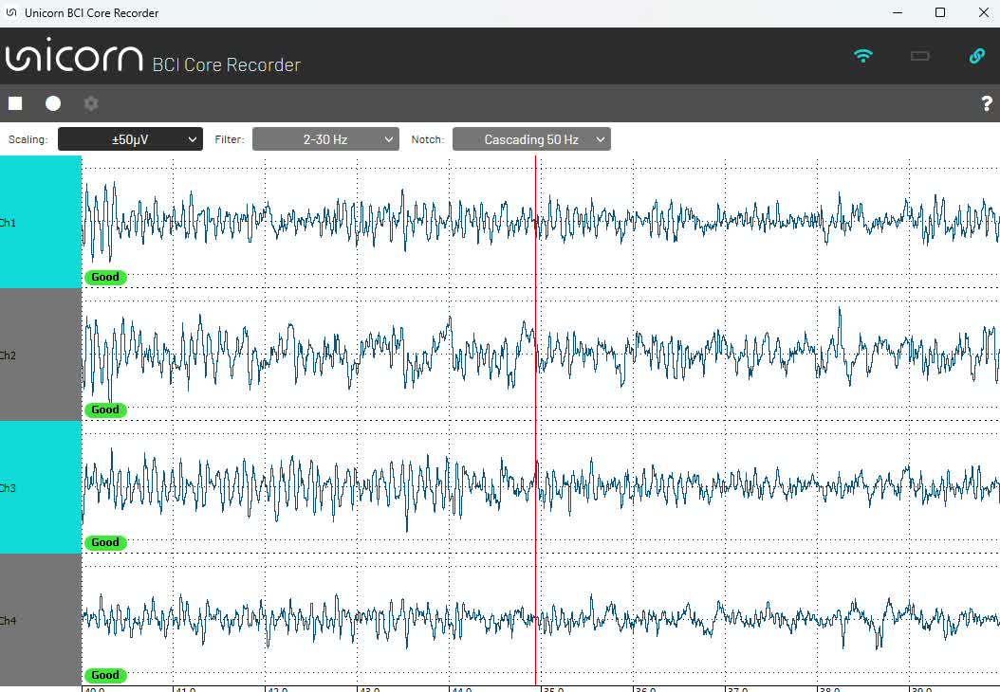

# Brain input for Meta Quest and Unity apps for €390

*Hands-free, gaze-free input and live mental-state signals (relaxation, attention) for VR, XR and game developers. In neuroscience this is called a brain-computer interface (BCI).*

**In short:** the Unicorn BCI Core-4 Headband (from €390 excl. VAT) streams EEG band power into Unity. Unity builds for Windows, macOS, Android, iOS and Android-based headsets such as **Meta Quest**. So any Quest owner can add live brain signals to a VR or XR app for the price of the headband.

## The signal you get
Live EEG from the Core-4 Headband in the free Unicorn BCI Core Recorder: 4 dry channels, ±50 µV scale, 2–30 Hz band-pass, 50 Hz notch, all channels marked "Good". Video: [core-4-headband-live-eeg.mp4](core-4-headband-live-eeg.mp4) (1:38, no sound).

## Why a standard headset
The Unicorn works with the Meta Quest, a mass-market standalone headset, instead of a special-purpose BCI headset. For developers that means:
- **Hardware people already own.** Add the €390 headband to a Quest instead of buying a dedicated headset for $25,000 or more.
- **Familiar tools.** Build in Unity for Android, with the free Unicorn plugins, the same way as any other Quest app.
- **Real distribution.** Publish through the Meta Horizon Store and Google Play, as g.tec did with the [Unicorn Labyrinth Game](https://www.meta.com/en-gb/experiences/unicorn-labyrinth-game/27322060354048623/).
- **No lock-in.** The same Unity app also builds for Windows, macOS, Android and iOS. For research, g.Pype pipelines written for the Unicorn also run on g.tec's lab amplifiers.

## How it works
1. Put on the [Unicorn BCI Core-4 Headband](https://www.gtec.at/product/unicorn-bci-core-4-headband/): 4 dry electrodes, 24-bit, 250 Hz, no gel, records within seconds.
2. Add the [Unicorn BCI Core Unity Bandpower Interface](https://github.com/unicorn-bi/Unicorn-BCI-Core-Unity-Bandpower-Interface) to your Unity project. It gives you real-time band power (for example alpha, beta) per channel.
3. Build for Meta Quest (Android). The headset talks to the Unicorn over Bluetooth.
4. Use the brain signal in your scene: relaxation changes the environment, concentration opens a door, attention drives a game.

Try it: the free **Unicorn Labyrinth Game**, a labyrinth you navigate with your brain, on the [Meta Quest store](https://www.meta.com/en-gb/experiences/unicorn-labyrinth-game/27322060354048623/), [Google Play](https://play.google.com/store/apps/details?id=com.gtec.labyrinth) and [GitHub](https://github.com/unicorn-bi/Unicorn-BCI-Core-Labyrinth-Game).

## Discrete commands: 30 targets after 30 s of calibration
For menus, keyboards and object selection, the free c-VEP add-on recognizes which of up to 30 flickering targets the user looks at, about 2 seconds per command, after about 30 seconds of calibration. Core-4 and Core-8, PC and Meta Quest. Videos: [showcases/cvep-30-targets](../cvep-30-targets/README.md).

## What you can build
Neurofeedback games, meditation and relaxation apps, attention training, VR research with brain data, art installations. For 8 channels use the Unicorn BCI Core-8 with the same plugin.

## Compared with integrated BCI headsets for VR and AR
OpenBCI Galea is a VR headset (Varjo) with built-in EEG, EMG, EDA, PPG and eye tracking. OpenBCI lists Galea at $42,980; earlier packages with a Varjo Aero or Varjo XR-3 were $25,000 and $34,000 ([OpenBCI shop](https://shop.openbci.com/collections/frontpage/openbci), [Galea packages](https://shop.openbci.com/zh-cn/products/galea), checked 25 October 2026).

Cognixion Axon-R is a standalone AR headset with EEG and BCI Studio software for labs. Cognixion lists it at $25,000 (Standard), $26,100 (Advanced) and $28,000 (Elite), with a $1,000 deposit ([Cognixion](https://axon-r.cognixion.com/purchaseaxon-r), checked 25 October 2026).

The Unicorn route adds EEG to a consumer headset instead: Unicorn BCI Core-4 Headband (€390 excl. VAT) plus a Meta Quest, bought separately. You get 4 dry EEG channels and the Unity plugin, not EMG, EDA, PPG or eye tracking. For many VR neurofeedback and attention apps, EEG band power is the signal you need, and the free c-VEP add-on gives up to 30 discrete commands ([showcase](../cvep-30-targets/README.md)).

## Real examples
- Hypnotize Dress by Anouk Wipprecht: Core-4 concentration signal drives eight displays (Ars Electronica 2026). See [domains/art-music-and-fashion.md](../../domains/art-music-and-fashion.md).
- BR41N.IO hackathon teams build Unity and VR projects with Unicorn devices in 24 hours. See [../hackathon](../hackathon/).
